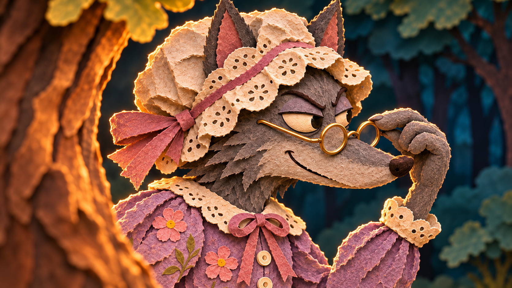
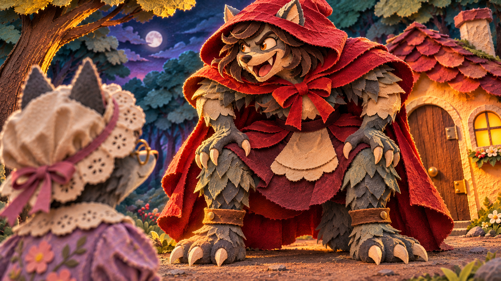
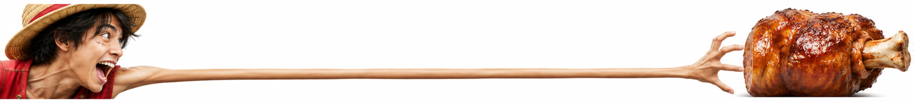

# Image2.6 视觉玩法库

**从一个故事、一张图片或一段文字出发，做出可以展示、修改和复用的视觉作品。**

这里整理四种玩法：纸雕定格动画、生物数字成长档案、横向二十连图和电影标题设计。每个模块提供对应的制作方法、提示词或 Skill，并按实际发布范围附上素材、脚本与案例。

[选择玩法](#选择玩法) · [看效果](#看效果) · [开始使用](#开始使用) · [Skill 入口](#skill-入口)

## 选择玩法

| 想做什么 | 准备什么 | 可以得到什么 | 进入模块 |
| --- | --- | --- | --- |
| 把故事做成有动作和反转的短片 | 文字故事，可附角色与场景参考 | 分镜、纸雕风格动画、GIF／MP4、可修改工程 | [02 定格剪纸风格动画](玩法库/02_定格剪纸风格动画/README.md) |
| 展示主体从一个阶段到另一个阶段的变化 | 按顺序整理的阶段图片，或先确定主体再制作素材 | 数字档案海报、阶段静帧、成长动效 | [04 生物数字成长档案](玩法库/04_生物数字成长档案/README.md) |
| 做一幅从左到右逐步揭晓的长图 | 一个主题，或一张已有横幅 | 超宽横幅、20 张顺序 PNG、切片 ZIP | [06 横向二十连图](玩法库/06_横向二十连图/README.md) |
| 给片头或品牌设计有电影感的标题 | 标题文字、画幅和喜欢的风格编号 | 标题视觉、可替换文字的提示词 | [07 电影标题设计](玩法库/07_电影标题设计/README.md) |

上表说明各玩法的制作方向；仓库里已经提供的文件与新主题需要补充的素材，见下方案例和模块说明。

## 看效果

### 02｜定格剪纸风格动画

**小红帽 · 门后的影子**：大灰狼树后换装、戴眼镜、敲门，小红帽在屋内偷看。门打开后，影子先变成巨兽，再揭示真身，最后切到狼的反应。

| 戴好眼镜 | 屋内偷看 | 巨兽反打 |
| --- | --- | --- |
|  |  |  |

上图为工程中的原始镜头素材。22 秒定稿采用十镜头叙事、分层动作与同步拟音；仓库提供 Skill、12 张源图、脚本和实际提示词，运行工程后生成成片。

[了解玩法与使用方法](玩法库/02_定格剪纸风格动画/README.md) · [复现小红帽定稿](玩法库/02_定格剪纸风格动画/skill/continuous-stop-motion-gif/references/final-case.md) · [打开 Skill](玩法库/02_定格剪纸风格动画/skill/continuous-stop-motion-gif/SKILL.md)

### 04｜生物数字成长档案

把独立的阶段图片放进统一档案版式，通过主体变化、坐标、细线和进度组织成长过程。海马 v21 提供五阶段基准工程，模块内还收录树蛙案例与迭代记录。


作品中的生物形态与成长过程为艺术化模拟，画面标注不代表实测数据。新主体需要重新准备阶段素材并适配过渡。

[查看制作方法](玩法库/04_生物数字成长档案/README.md) · [海马 v21 与完整文件](玩法库/04_生物数字成长档案/案例/海马_v21/README.md) · [浏览更多案例](玩法库/04_生物数字成长档案/案例/README.md)

### 06｜横向二十连图

让人物或物体分居画面两端，用伸长的手臂、剑身等元素连接中段，再从左到右导出 20 张图片。可以选择连续等分，也可以按展示布局做间隔补偿。



仓库提供“路飞 VS 食物”和“索隆 VS 鹰眼”案例、整图与切片下载。间隔补偿效果取决于实际客户端布局。

[查看案例与下载切片](玩法库/06_横向二十连图/README.md) · [制作与导出 Skill](玩法库/06_横向二十连图/skill/panorama-20/SKILL.md)

### 07｜电影标题设计

从 CT-01 到 CT-32，按字形、材质、构图和光线选择标题方向，再替换成自己的文字。下方用 DMIAO 展示 32 款设计，静态索引便于逐款比较。


[查看 32 款案例](玩法库/07_电影标题设计/README.md) · [打开静态索引](玩法库/07_电影标题设计/assets/atlas.png) · [按编号查提示词](玩法库/07_电影标题设计/catalog/index.md) · [使用说明](玩法库/07_电影标题设计/使用与案例.md)

## 开始使用

1. **先选效果。** 从上面的案例进入模块，查看需要的素材与输出形式。
2. **选一种用法。** 可以复制提示词自行创作，也可以按模块说明安装 Skill，或用包内脚本复现指定案例。
3. **把要求说具体。** 写明主体、参考用途、必须保留的细节、画幅和输出形式；已有角色或成片时，一起提供。
4. **检查后导出。** 看清主体结构、文字、动作与接点；有声音的作品还需试听。修改工程时保留原始版本。

Skill 是供 Agent 使用的制作说明与配套资源。下载仓库不会自动安装 Python 依赖或生成模型；各模块分别说明运行条件。

<details>
<summary><strong>复制一个示例，开始制作</strong></summary>

**复现小红帽定稿动画**

```text
使用 $continuous-stop-motion-gif，复现小红帽《门后的影子》定稿动画。
保持十镜头叙事、影子先变和同步拟音，交付 MP4 与 GIF。
```

**把自己的素材做成成长档案**

```text
使用 $specimen-growth-archive，把我上传的阶段素材做成数字成长档案。
保持各阶段主体的轮廓与纹理，按文件顺序展示。
先制作阶段静帧与过渡预览，画面中的未核实数据标为模拟示意。
```

**把已有横幅切成 20 张图**

```text
使用 $panorama-20，把这张横幅从左到右连续等分为 20 张 PNG。
保持原图高度，按 01.png 至 20.png 命名，并打包 ZIP。
```

**替换电影标题**

```text
按 CT-11 的日蚀构图，把标题替换成「YOUR TITLE」，做成 16:9 横版。
保留该款的文字层级、空间关系与光线方向。
```

</details>

## Skill 入口

| 模块 | Skill／模板入口 | 安装或复现说明 |
| --- | --- | --- |
| 定格剪纸风格动画 | [continuous-stop-motion-gif](玩法库/02_定格剪纸风格动画/skill/continuous-stop-motion-gif/SKILL.md) | [小红帽定稿工程](玩法库/02_定格剪纸风格动画/skill/continuous-stop-motion-gif/references/final-case.md) |
| 生物数字成长档案 | [specimen-growth-archive](玩法库/04_生物数字成长档案/skill/specimen-growth-archive/SKILL.md) | [使用说明](玩法库/04_生物数字成长档案/skill/specimen-growth-archive/README.md) |
| 横向二十连图 | [panorama-20](玩法库/06_横向二十连图/skill/panorama-20/SKILL.md) | [主题生成与切片方法](玩法库/06_横向二十连图/README.md) |
| 电影标题设计 | [Cinematic Title Director](玩法库/07_电影标题设计/SKILL.md) | [使用与案例](玩法库/07_电影标题设计/使用与案例.md) |

通过仓库的 **Code → Download ZIP** 下载后，按模块说明选择需要的 Skill 文件夹，完整保留其引用的素材和脚本。只想使用提示词时，可以直接打开对应文本并替换主体或标题。

生成结果、技术自检与用户视听验收分别记录，具体状态和素材使用说明见各模块。“Image2.6”是项目名称，实际工具、模型与版本以案例记录为准。

[完整项目导航](项目导航.md) · [发布范围记录](发布准备/上传范围.md)
