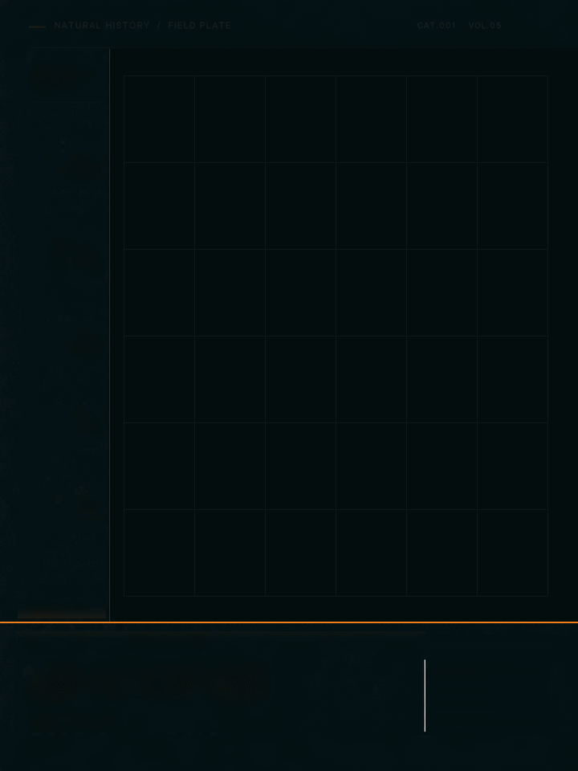

# Image2.6 视觉玩法库

把图片变成可以继续探索的视觉玩法：从已有素材出发，制作有设计感的静态画面和动态作品。

这里逐步整理玩法效果、案例和可复用 Skill。你可以先看案例，再根据自己的素材选择制作方式。

[查看已发布玩法](#已发布玩法) · [海马案例](玩法库/04_生物数字成长档案/案例/海马_v21/README.md) · [Skill 使用说明](玩法库/04_生物数字成长档案/skill/specimen-growth-archive/README.md)

## 已发布玩法

| 玩法 | 能做什么 | 入口 |
| --- | --- | --- |
| 04 生物数字成长档案 | 将不同阶段的主体结合摄影质感与图形标注，制作静态档案或成长动画 | [玩法介绍](玩法库/04_生物数字成长档案/README.md) |

## 04 生物数字成长档案

让不同阶段的主体在同一画面里连续变化，再加入坐标节点、细线、阶段名称和成长进度，形成数字档案视觉。

海马案例使用五个独立阶段的主体素材，做成 3:4 竖版成长动画；主体形态、数据图层和背景分开处理。

[查看案例与完整文件](玩法库/04_生物数字成长档案/案例/海马_v21/README.md) · [了解如何使用 Skill](玩法库/04_生物数字成长档案/skill/specimen-growth-archive/README.md)

> 可以这样说：使用 `$specimen-growth-archive`，把我提供的不同阶段主体素材做成数字成长档案，保留原图形态、纹理与关键结构，画面用深色背景、细线标注和成长进度。

## 更多案例与迭代过程

- [树蛙版本迭代](玩法库/04_生物数字成长档案/案例/树蛙_迭代记录/README.md)：从六阶段成长到透明标注与竖版排版。
- [海马版本迭代](玩法库/04_生物数字成长档案/案例/海马_迭代记录/README.md)：查看从早期动态、版式调整到原图保真复测的过程。

## 可以提供什么

主体照片、多个成长阶段的图片、想参考的版式或动效，都可以作为输入。请说明哪些是必须保留的主体，哪些只作风格参考，以及想要静态图、GIF 还是视频。

只有一张主体图时，需要先准备各阶段不同形态的素材；不能简单缩放成体，冒充不同生长阶段。包内可运行基准目前只验证了海马素材；其他主体需要重新制作阶段图、遮罩和对应关系。

## 案例状态

海马案例已经完成技术检查及视觉自检，**用户视觉验收尚未确认**。案例中的阶段、数字和进度用于艺术展示，不代表经核实的真实生物年龄或测量数据。

## 后续更新

每个玩法会在资料整理完成后逐步加入。实际使用的平台、模型与版本，以案例记录为准；“Image2.6”是本项目名称。
