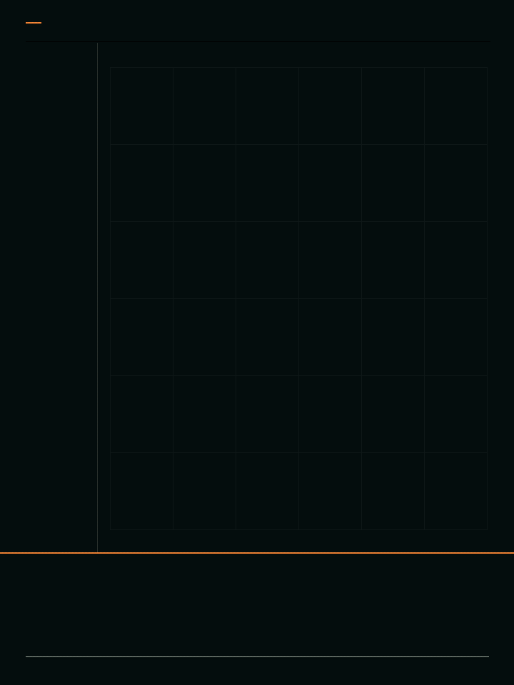
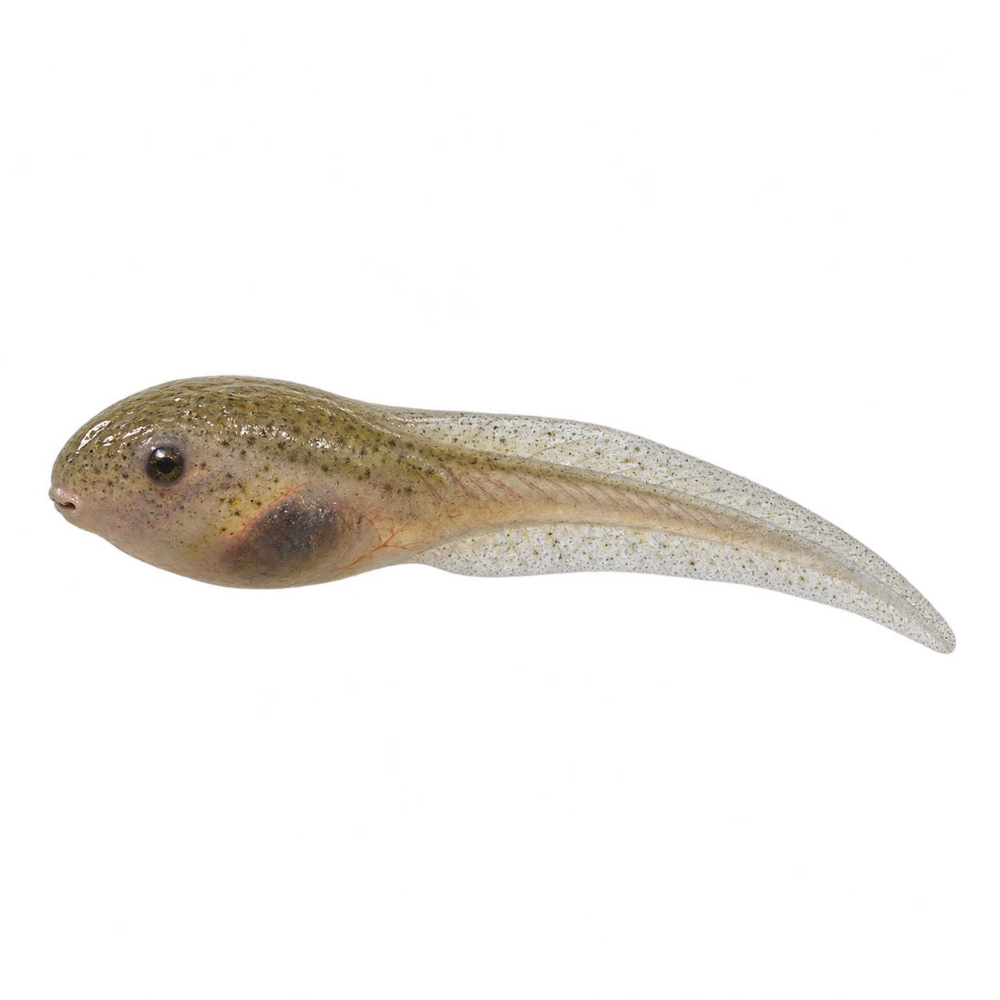
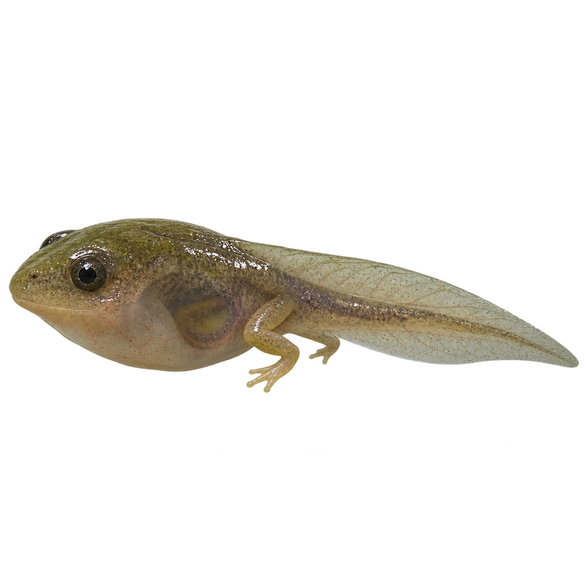
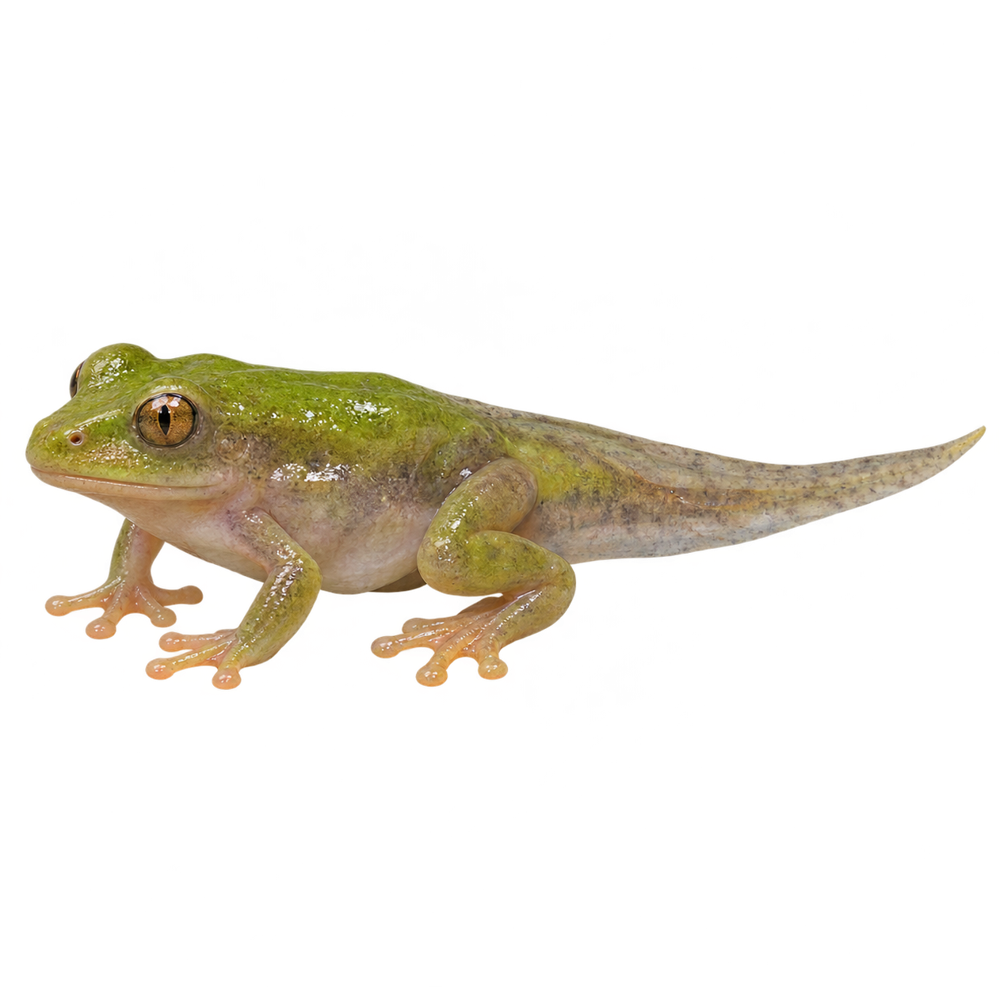
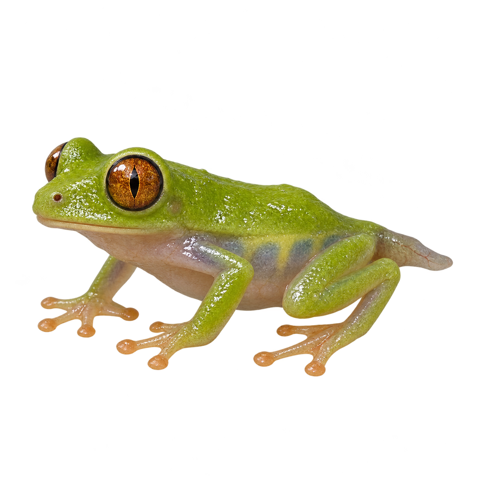
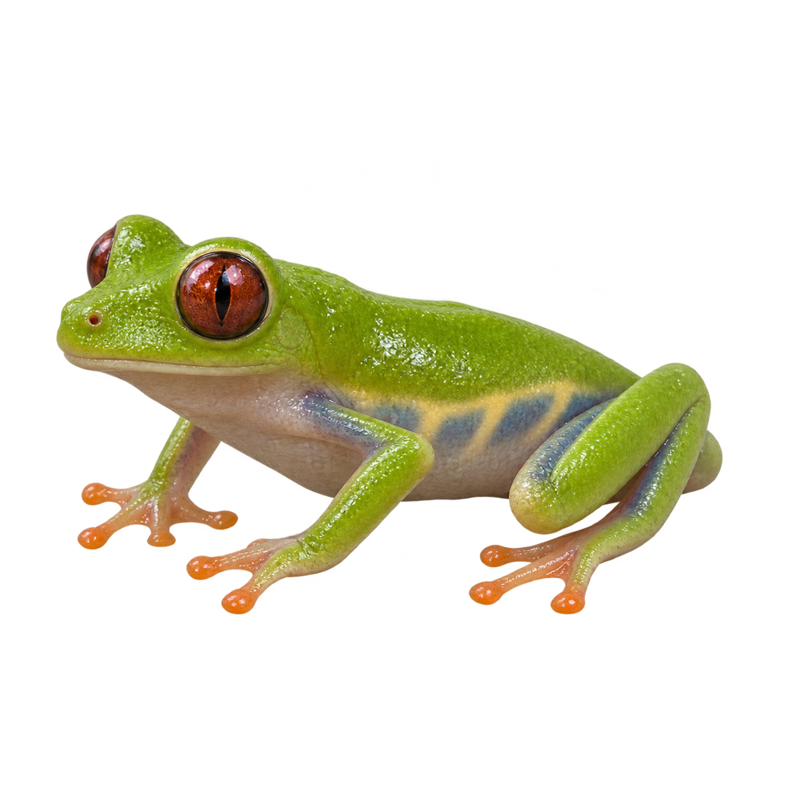
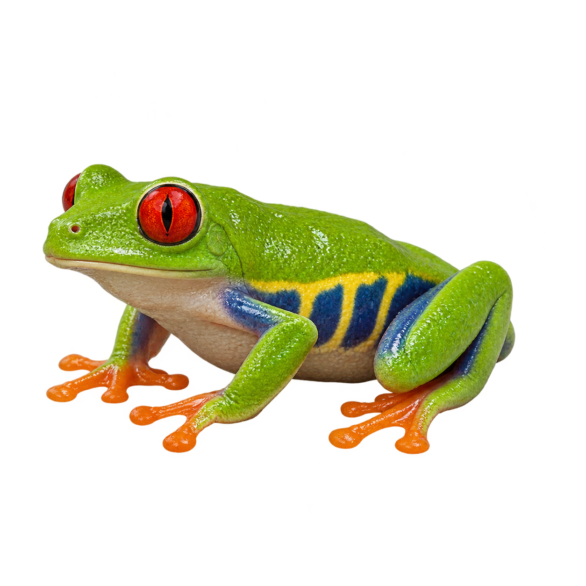

# 04｜生物数字成长档案

[返回首页](../../README.md) · [查看海马案例](案例/海马_v21/README.md) · [Skill 使用说明](skill/specimen-growth-archive/README.md)

将独立成长阶段的主体图片，结合摄影质感、坐标节点、细线与进度信息，制作数字档案海报或成长动效。

## 看效果

### 海马 v3｜早期版本


### 最新案例

| 海马 v21｜原图形变复测 | 红眼树蛙｜2026-11-13 版 |
| --- | --- |
|  |  |

[查看海马 v21](案例/海马_v21/README.md) · [查看新版树蛙案例](案例/树蛙_20261113/README.md) · [树蛙历史迭代](案例/树蛙_迭代记录/README.md)

v3 是早期 3:4 竖版成长动画；v21 进一步围绕五阶段原图和过渡进行保真复测。两版展示的是不同阶段的制作探索。

v21 为 720×960、25 fps、12 秒循环。原始 GIF、MP4 和成熟期静帧见 [v21 案例目录](案例/海马_v21/README.md)，更多历史版本见[海马迭代记录](案例/海马_迭代记录/README.md)。这些作品是艺术化示意，技术检查和视觉自检已完成，用户视觉验收尚未确认。

### 树蛙的六个阶段素材

下面展示六张独立的阶段图，用于说明从素材到成长动效的制作思路。图像为艺术化模拟，不是真实个体的连续发育照片；本组第六张与新版成片使用的原始素材文件不同。

| 01 蝌蚪期 | 02 后肢期 | 03 四肢期 |
| --- | --- | --- |
|  |  |  |
| **04 幼蛙期** | **05 亚成体** | **06 成蛙期** |
|  |  |  |

[查看和下载六张阶段图](案例/树蛙_迭代记录/阶段素材/)

## 案例与迭代

[浏览树蛙与海马案例和迭代过程](案例/README.md)。不同案例的制作方法和完成状态见各自说明。

## 能做什么

- 将多个独立阶段整理成统一的成长视觉。
- 以主体图、网格、节点、细线、文字和进度分别组织画面。
- 用包内海马基准复跑示例，输出预览、静帧、GIF 与 MP4。
- 依据用户提供的主体和参考，规划新主题的素材与版式。

海马示例不是通用的任意图片动画器。新主体需要准备其各阶段素材，并重新设计遮罩、结构对应及运动；其他生物的效果尚未由该示例脚本验证。

## 怎么使用

### 第一步：准备主体素材

选择想展示的生物或其他主体，尽量准备各阶段独立的清晰图片，并按成长顺序命名。主体朝向、光线和画面风格尽量一致，便于建立阶段之间的对应；需要保留的轮廓、纹理和关键结构请提前说明。透明背景或背景干净的图片更方便分层处理。

如果只有一张图，可以先用它说明目标主体，再准备不同阶段的独立形态。阶段数量由主题和素材决定；不能简单把成体缩小，当作幼体。

### 第二步：安装 Skill

1. 下载仓库，找到 [specimen-growth-archive 文件夹](skill/specimen-growth-archive/)；也可以从仓库首页使用 **Code → Download ZIP** 下载整个仓库。
2. 将整个 `specimen-growth-archive` 文件夹复制到 Codex 的技能目录，保留 `SKILL.md`、`references`、`scripts` 和 `assets` 等子目录。
3. 开启新的 Codex 对话，上传主体素材，并在需求中写上 `$specimen-growth-archive`。

安装只提供制作流程和海马基准脚本，不会自动安装 Python 依赖或生成模型。具体配置见 [Skill 使用说明](skill/specimen-growth-archive/README.md)。

### 第三步：描述你想要的效果

告诉 Codex 主体是什么、图片先后顺序、哪些细节不能改、参考图只用于什么，以及想要静态海报、GIF 还是 MP4。还可以指定画幅、时长、版式和文字信息。以下内容可以复制后按需修改：

```text
使用 $specimen-growth-archive，把我上传的阶段素材制作成数字成长档案。
主体：［填写名称］；阶段顺序：［依次填写］。
请保留每个阶段的主体轮廓、纹理和关键结构，参考图仅用于版式。
画面：3:4 竖版、深色背景、细线坐标和成长进度。
输出：先给我阶段静帧和过渡预览，确认后再制作 GIF 和 MP4。
未核实的物种资料和数字请标注为模拟示意。
```

### 第四步：检查与导出

先看各阶段静帧及过渡预览，重点检查主体结构、肢体或尾部、纹理、标注遮挡和阶段衔接；有问题先调整再导出。最终检查 GIF 和 MP4 的画幅、时长、循环及实际播放效果。技术检查和制作者视觉自检不等于用户验收。

### 想复跑海马案例？

包内提供海马 v21 的基准素材和脚本。需要 Python 3.10+、NumPy、Pillow、OpenCV，导出 GIF 和 MP4 还需 FFmpeg；字体要求和预览、完整导出命令见[海马基准复跑说明](skill/specimen-growth-archive/references/seahorse-baseline.md)。建议先运行预览，再检查关键帧，最后导出成片。

**这个脚本只验证过包内五阶段海马素材和对应版式。** 树蛙或其他主体要重新制作阶段素材、遮罩和结构对应，不能只替换图片就保证得到同样的动效。

## 使用前请注意

- **案例是模拟展示。** 生物形态、成长过渡和画面标注用于视觉创作，不是真实个体的生长记录；坐标、进度及示意数字也不能直接当作生物测量数据。
- **真实资料需要核验。** 如用于科普、教育、研究或其他需要准确性的场景，请核对物种名称、各阶段形态、图片来源、年龄和尺寸等信息，并依据可靠资料标明来源；未经核实的内容请明确标注为示意。
- **留意素材和作品授权。** 使用照片、插画、字体、音乐或其他素材前，请确认其使用许可覆盖你的用途，包括公开发布、修改及商业使用；按许可要求署名或取得权利人授权。参考他人作品时，避免直接复制受保护的素材和具体表达。
- **标清素材来源与生成方式。** 分享作品时，说明哪些是实拍或真实资料、哪些是 AI 生成或艺术重建，避免让观看者误以为模拟画面是真实记录。
