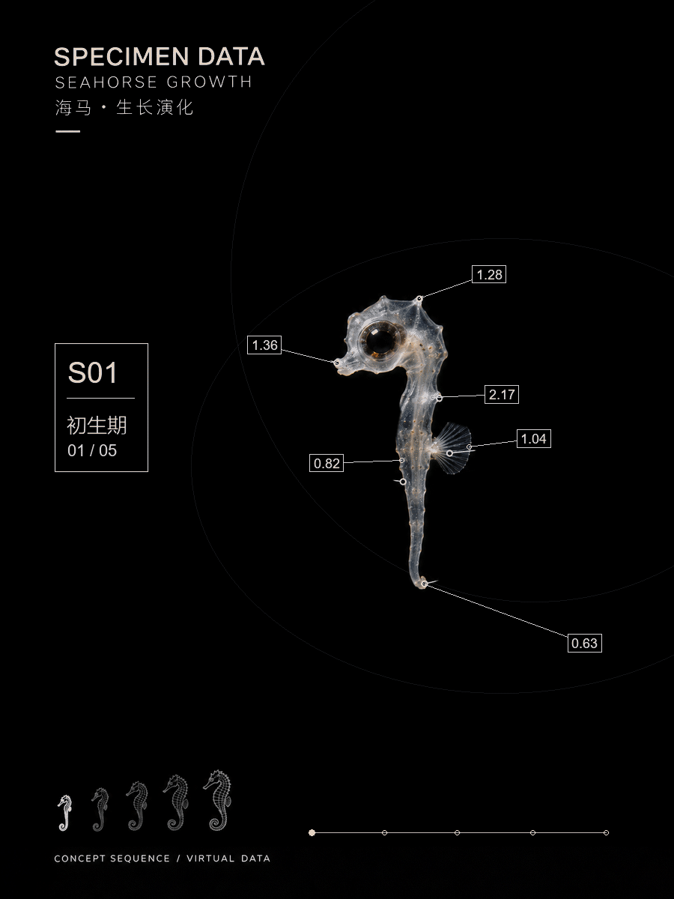
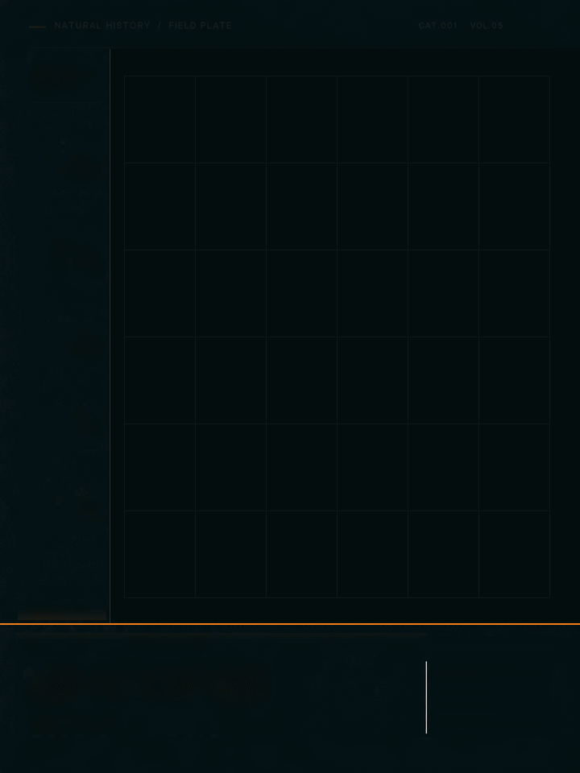

# 04｜生物数字成长档案

[返回首页](../../README.md) · [查看海马案例](案例/海马_v21/README.md) · [Skill 使用说明](skill/specimen-growth-archive/README.md)

将独立成长阶段的主体图片，结合摄影质感、坐标节点、细线与进度信息，制作数字档案海报或成长动效。

## 看效果

### 海马 v3｜早期版本

### 海马 v21｜原图形变复测

v3 是早期 3:4 竖版成长动画；v21 进一步围绕五阶段原图和过渡进行保真复测。两版展示的是不同阶段的制作探索。

v21 为 720×960、25 fps、12 秒循环。原始 GIF、MP4 和成熟期静帧见 [v21 案例目录](案例/海马_v21/README.md)，更多历史版本见[海马迭代记录](案例/海马_迭代记录/README.md)。这些作品是艺术化示意，技术检查和视觉自检已完成，用户视觉验收尚未确认。

## 使用前请注意

- **案例是模拟展示。** 生物形态、成长过渡和画面标注用于视觉创作，不是真实个体的生长记录；坐标、进度及示意数字也不能直接当作生物测量数据。
- **真实资料需要核验。** 如用于科普、教育、研究或其他需要准确性的场景，请核对物种名称、各阶段形态、图片来源、年龄和尺寸等信息，并依据可靠资料标明来源；未经核实的内容请明确标注为示意。
- **留意素材和作品授权。** 使用照片、插画、字体、音乐或其他素材前，请确认其使用许可覆盖你的用途，包括公开发布、修改及商业使用；按许可要求署名或取得权利人授权。参考他人作品时，避免直接复制受保护的素材和具体表达。
- **标清素材来源与生成方式。** 分享作品时，说明哪些是实拍或真实资料、哪些是 AI 生成或艺术重建，避免让观看者误以为模拟画面是真实记录。

## 案例与迭代

[浏览树蛙与海马案例和迭代过程](案例/README.md)。不同案例的制作方法和完成状态见各自说明。

## 能做什么

- 将多个独立阶段整理成统一的成长视觉。
- 以主体图、网格、节点、细线、文字和进度分别组织画面。
- 用包内海马基准复跑示例，输出预览、静帧、GIF 与 MP4。
- 依据用户提供的主体和参考，规划新主题的素材与版式。

海马示例不是通用的任意图片动画器。新主体需要准备其各阶段素材，并重新设计遮罩、结构对应及运动；其他生物的效果尚未由该示例脚本验证。

## 使用

下载 [specimen-growth-archive](skill/specimen-growth-archive/) 文件夹，按 [使用说明](skill/specimen-growth-archive/README.md) 安装并检查依赖。你也可以直接阅读 [SKILL.md](skill/specimen-growth-archive/SKILL.md) 了解制作流程。

> 使用 `$specimen-growth-archive`，将我提供的阶段素材制作成数字成长档案。保持主体比例和原有关键结构，使用细线与坐标节点展示阶段变化。

具体物种、年龄与物理尺寸应有可靠依据；示意性数字应明确说明。
