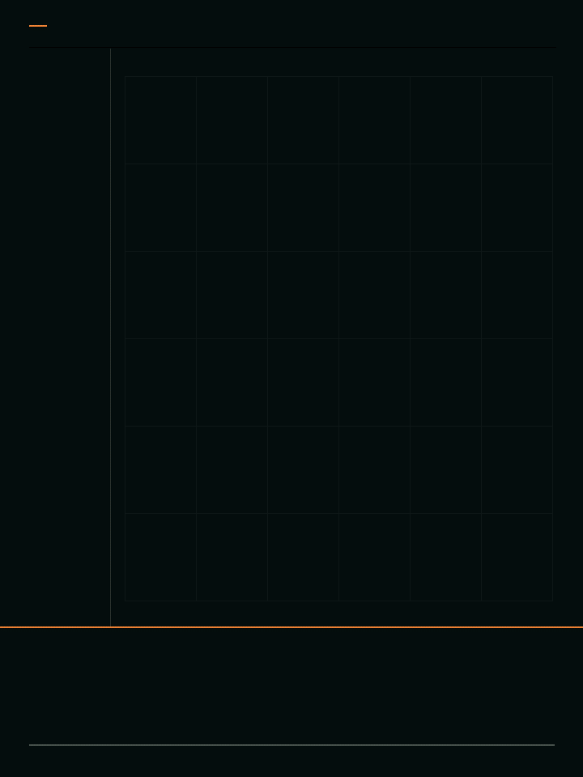

# 红眼树蛙｜数字成长档案 2026-11-13 版

这版复用历史案例中的六张独立 AI 主体图及结构对应点，重新制作 3:4 版式、数据标注与成长动画，按蝌蚪、后肢、四肢、幼蛙、亚成体、成蛙依次展示；不包含卵期。

[下载 GIF](红眼树蛙_数字成长档案.gif) · [下载 MP4](红眼树蛙_数字成长档案.mp4) · [六阶段总览](六阶段总览.jpg) · [旧版树蛙迭代](../树蛙_迭代记录/README.md)

成片为 720×960、12 秒、25 fps；原始核验记录显示 GIF 和 MP4 均为 300 帧，GIF 无限循环。用户视觉验收尚未记录。

作品使用二维形变与图像混合，是艺术化成长示意，不是真实动物延时摄影。画面坐标和角度是二维图像信息，成长百分比是动画进度，不代表真实生长数据。
