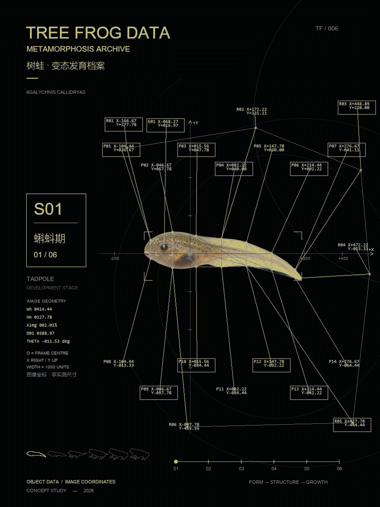

# 树蛙案例｜四个版本的变化

将六张独立生成的树蛙阶段素材，从蝌蚪、后肢、四肢、幼蛙、亚成体过渡到成蛙，制作成数字档案动画。以下是同一案例的四次迭代。

| 版本 | 调整内容 | 原始成片 |
| --- | --- | --- |
| v1 | 六阶段连续过渡，方形画幅，数字作为虚拟标注。 | [查看 GIF](v1.gif) |
| v2 | 增加密集节点，改用由画面位置计算的二维坐标与图像几何数据。 | [查看 GIF](v2.gif) |
| v3 | 去掉坐标标签与节点的黑色填充，使标注更通透。 | [查看 GIF](v3.gif) |
| v4 | 从方形改为 3:4 竖版，重新安排主体、阶段栏和标注空间。 | [查看 GIF](v4.gif) · [阶段检查图](v4_阶段检查.jpg) |

v1–v3 为 900×900，v4 为 900×1200；四版均为 10 秒循环。根据原始检查记录，GIF 已做全帧解码与阶段抽样自查，用户最终视觉验收尚未确认。

这是 AI 图像构成的艺术发育示意，不是真实延时摄影，也未经逐阶段物种学验证；二维形变中局部肢体与皮肤纹理可能叠化。v2 起的坐标是画面几何位置，不是动物的实际尺寸或年龄。树蛙案例早于当前 Skill 的整理，不表示海马基准脚本可以直接用于树蛙。

[案例索引](../README.md) · [海马迭代](../海马_迭代记录/README.md)
