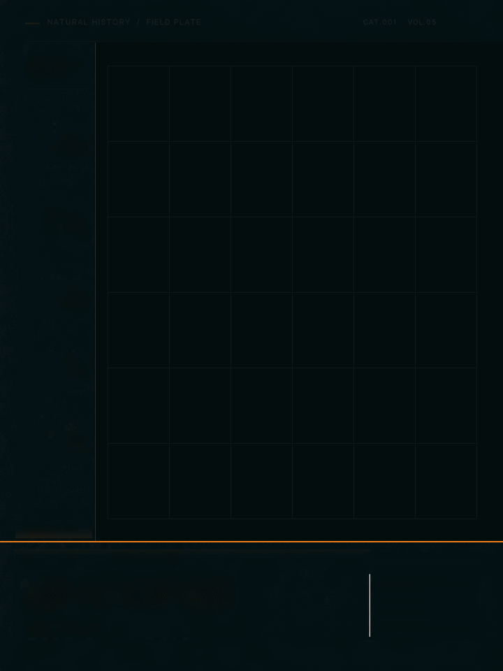

# 海马数字成长档案｜v21

[返回玩法](../../README.md) · [返回首页](../../../../README.md)

五个独立阶段的海马主体结合数字档案版式，按阶段连续过渡。原文件为 720×960、25 fps、300 帧、12 秒的循环 GIF，同时提供无音轨 MP4 和成熟期静帧。

- [下载 GIF](海马成长_v21.gif)
- [下载 MP4](海马成长_v21.mp4)
- [成熟期静帧](成熟期.png)
- [历史复测说明](历史复测说明.md) · [历史导出检查](历史导出检查.json)
- [复跑技能与基准素材](../../skill/specimen-growth-archive/README.md)

案例已做技术检查和视觉自检；用户视觉验收尚未确认。它是艺术化的海马成长示意，具体物种、真实年龄与物理尺寸未得到证明。进度和坐标用于画面展示，不应当作生物实测数据。
