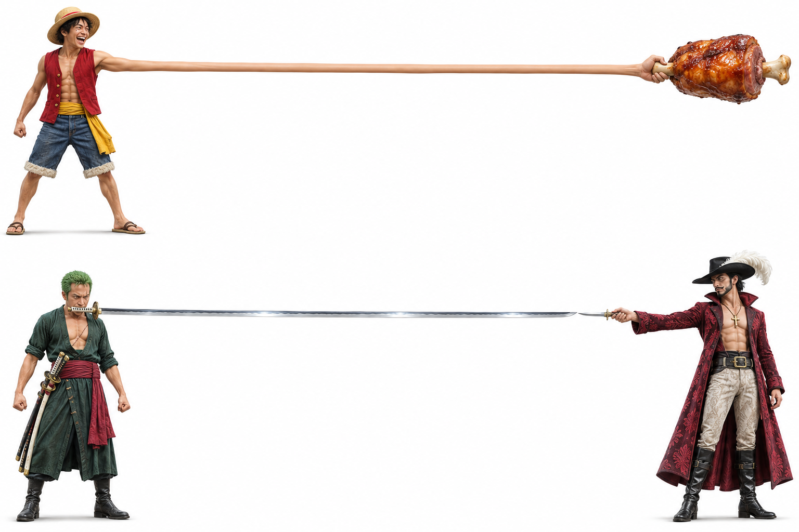

# 06｜横向二十连图

[返回首页](../../README.md)

把故事的起点与终点放在一张超宽横图的两端，用延伸的动作或物体连接中间。按从左到右的顺序切成 20 张图片后，可用于连续浏览的创意展示。

上图展示了伸长手臂与长剑两种连接方式，是构图示意图，不是已经完成的 20 张切片。

## 如何构思和使用

1. **确定两端内容**：例如人物与食物、两个人物之间的对峙，或一个动作的起点与终点。
2. **设计中间的连接**：让手臂、剑身、绳索或其他连续元素横贯画面，并给两端主体留出足够空间。
3. **制作超宽横幅**：准备已有横图，或依据构思制作新的长图；检查连接处和两端主体是否完整。
4. **按顺序切片**：根据目标平台的显示方式切成 20 张，按 `01` 至 `20` 排列。若需要无缝拼回原图，使用连续等分；若要适配展示间隔，可结合实际平台画面调整切片窗口。
5. **检查实际效果**：重点看首尾主体、接触点、跨图连接、图片顺序和平台裁切。不同设备与客户端的显示方式可能不同。

## 使用素材时

图片中的角色和造型仅作视觉示意。公开发布或商业使用作品时，请核实角色形象、原图和其他素材的使用许可，并按需要取得授权；也可以使用自己的原创角色和素材。
