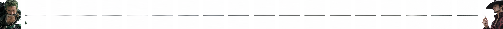
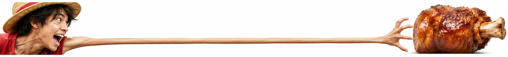

# 横向二十连图

让两个主体分居超宽画幅两端，用剑身或橡胶手臂贯穿中段。每个压缩包包含从左到右排列的 01.png 至 20.png。X 补偿版按参考截图的窗口与白缝比例 73∶16 跳过遮挡区域，实际显示取决于客户端布局。

## 使用方法

### 方法 1 · 给一个主题，直接生成横幅

> 用 panorama-20 做「路飞 VS 食物」，生成横向长图，按 X 间隔补偿从左到右切成 20 张 PNG，打包成 ZIP。

只需提供主题。这个例子里，路飞在左，带骨肉在右，伸长的橡胶手臂贯穿中段。默认横幅为 7280 × 822 像素。

### 方法 2 · 上传原图，延长中段后等分

上传图片，再复制这条指令：

> 请帮我把这张图中间的剑身自然延长到约 6,373.5 像素，让刃纹和反光连贯，两端人物保持原比例。然后把整张横图从左到右切成 20 张等宽 PNG，按 01.png 到 20.png 的顺序导出到「索隆VS鹰眼」文件夹。

这里量的是从刀镡到刀尖的长度，实际制作时取整为约 6374 像素。按这条指令导出的 20 张图可以无缝拼回整图。若要发 X，可把“切成 20 张等宽 PNG”改为“按 X 间隔补偿切成 20 张 PNG”。

## 索隆VS鹰眼

横幅 30000 × 1789，补偿切片每张 1241 × 1789。



[整图](案例/索隆VS鹰眼/横幅.png) · [下载 20 张补偿 PNG](案例/索隆VS鹰眼/X间隔补偿.zip)

## 路飞VS食物

横幅 7280 × 822，补偿切片每张 301 × 822。



[整图](案例/路飞VS食物/横幅.png) · [下载 20 张补偿 PNG](案例/路飞VS食物/X间隔补偿.zip) · [下载无缝等分版](案例/路飞VS食物/连续等分.zip)

## 复用玩法

[技能与运行说明](skill/panorama-20/SKILL.md)。已有横幅可用 Python 和 Pillow 直接导出。

```sh
python skill/panorama-20/scripts/export.py input.png output-folder --x-gap
```
