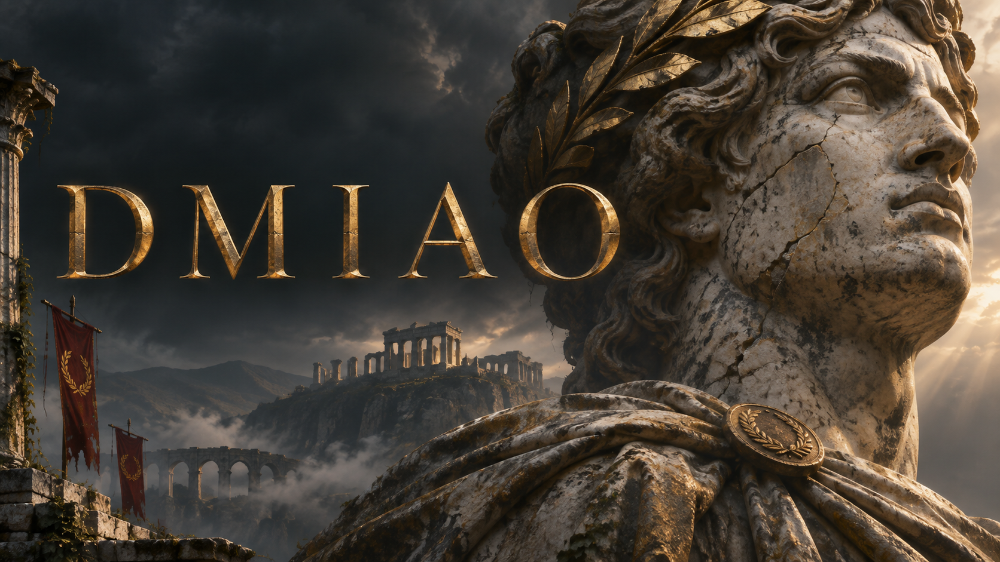
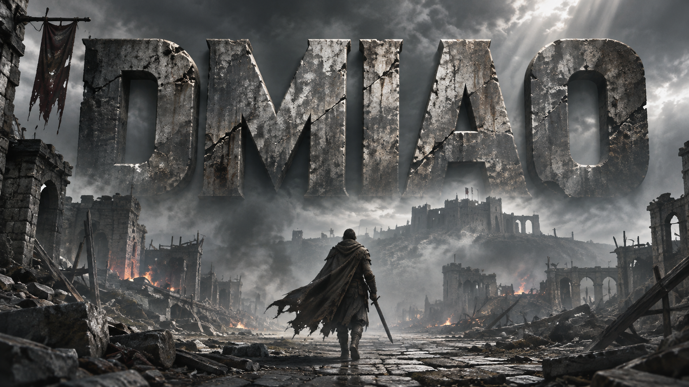
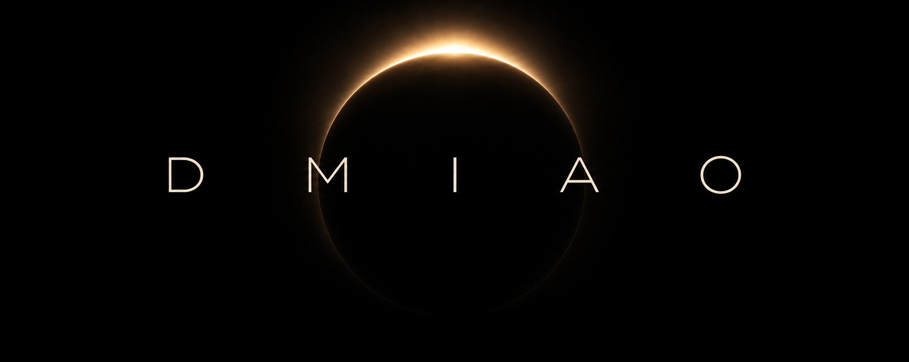
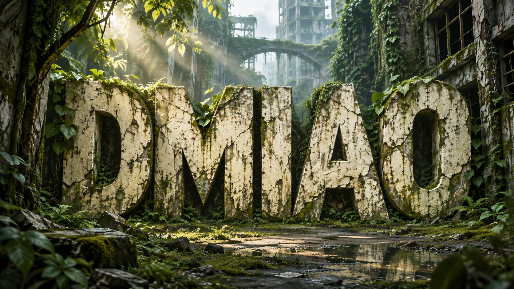
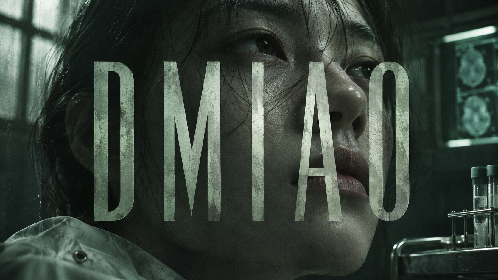
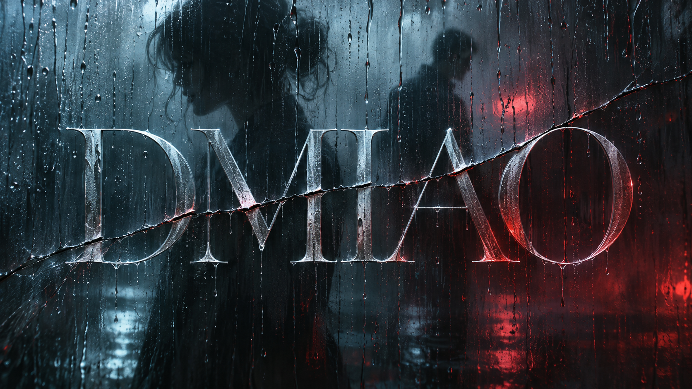

# Cinematic Title Director

用 CT-01 至 CT-32 选择电影片头或品牌标题的字形、构图和光线，输入自己的文字，生成对应视觉。

[打开 32 款成品画廊](preview.html) · [按编号查提示词](catalog/index.md)

以下为以 DMIAO 为主题的 AI 生成预览，CT-27 沿用 DMIAO COFFEE 横稿。点击每张图片可看原图。生成字形以成图为准，用户可以选择后期用授权字体重新排字。

| **CT-01 星际孤境**  | **CT-02 大理石王朝**  | **CT-03 雾林倒影**  | **CT-04 绯红丝绒**  |
|---|---|---|---|
| **CT-05 监墙刻痕**  | **CT-06 落日签名**  | **CT-07 雪峰星标**  | **CT-08 深水低语**  |
| **CT-09 野花恋曲**  | **CT-10 灰城前线**  | **CT-11 日蚀留白**  | **CT-12 双色霓虹**  |
| **CT-13 王室金字**  | **CT-14 复古红光**  | **CT-15 荒原工业**  | **CT-16 废城求生**  |
| **CT-17 极简轨道**  | **CT-18 度假讽喻**  | **CT-19 冷调侧写**  | **CT-20 政局暗线**  |
| **CT-21 海浪笔刷**  | **CT-22 暗潮家族**  | **CT-23 棋局古典**  | **CT-24 幻城鎏金**  |
| **CT-25 数字残影**  | **CT-26 荒野手记**  | **CT-27 沙丘几何**  | **CT-28 暗巷重字**  |
| **CT-29 仪式烛火**  | **CT-30 声波取证**  | **CT-31 雨玻璃折裂**  | **CT-32 风暴海岸**  |

## 使用
将整个仓库目录命名为 cinematic-title-director，放入支持本地 Skill 的工具的技能目录。也可以直接复制 prompts 中的英文提示词，替换 TITLE、FORMAT 和 ASPECT_RATIO。

例如“CT-11 DMIAO”，沿用该款横幅日蚀构图。“CT-27，标题换成 DMIAO COFFEE，做 16:9 品牌海报”，按标题长度安排主副行。

[Skill 入口](SKILL.md) · [字体候选](fonts/verified-ofl-candidates.csv) · [素材及许可](NOTICE.md) · [生成记录](assets/manifest.json) · [MIT 许可](LICENSE)

维护时运行 python scripts/build_catalog.py，校验文件哈希并重建画廊、目录及 ZIP。

## 使用说明与案例

[完整使用方法、素材来源和注意事项](使用与案例.md) · [5 秒案例轮播](assets/dmiao-32-styles-5s.gif)

