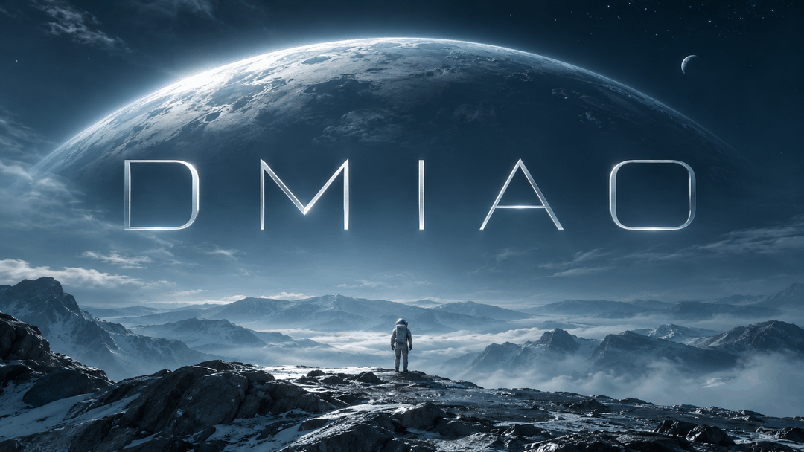

# 使用方法、案例与素材说明

## 玩法介绍
Cinematic Title Director 将 32 种电影标题设计方向整理成编号菜单，用于电影片头、品牌标题和海报。选择 CT 编号，提供原文和用途，即可取得对应构图提示词或生成成图。每款保持稳定编号，字形、字距、光线、标题位置和场景共同构成方向。

## 三种使用方式
- 在聊天中调用，例如“CT-11 DMIAO”，使用日蚀留白；“CT-27，DMIAO COFFEE，16:9”，使用沙丘几何。
- 手动打开 prompts/ 下对应文件，把 TITLE、FORMAT、ASPECT_RATIO 换为标题、用途和画幅，再交给图像生成工具。
- 本地安装时，将本模块完整复制并命名为 cinematic-title-director，放入工具支持的技能目录。生成使用可用的图像工具；构建画廊的脚本只整理已存在的图片。

## DMIAO 成品案例
[32 款成品选款表](catalog/index.md)按 CT-01 至 CT-32 列出原图和英文提示词。[画廊](preview.html)可下载到本地后用浏览器打开；GitHub 阅读时用模块 README 的图片表格或[总览 PNG](assets/atlas.png)。

本组使用 DMIAO 统一比较效果。CT-11「日蚀留白」采用此前修订的黑底日蚀横稿；CT-27「沙丘几何」采用 DMIAO COFFEE 横稿。其余 30 张是随后独立生成的新图。实际尺寸、生成提示词或先前生成摘要、哈希及检查状态见[素材记录](assets/manifest.json)。

新图是对设计机制的具体演绎，部分款式增强了立体材质、场景物化或装饰。编号用于选款，参考图与新成品之间的字形和构图差异需要结合 brief 判断。用户指定参考格时，先看该格再设计。统一使用短词 DMIAO 的本组案例，也不能验证长片名、多行文字或中文标题的效果；这些输入需要单独排版。

## 5 秒案例轮播


GIF 将 32 张静态图按 CT-01 → CT-32 各展示一次，随后无限循环。尺寸 1080×608，总时长准确为 5000 ms，32 个编码帧，单张为 150 或 160 ms。不同画幅按比例完整放入黑底画布，保留全图。实际文件约 15.4 MB。这是快速选款轮播，画面内部没有额外运动；查看细节请打开静态原图。

依赖 Python 3.10+ 和 Pillow。复跑命令在本模块目录执行：

```bash
python -m pip install Pillow
python scripts/render_gif.py --manifest cases/dmiao-32-styles-5s.json --output-dir gif-output
```

[相对路径清单](cases/dmiao-32-styles-5s.json) · [编码校验记录](cases/gif-verification.json)

## 字形和字体授权
成品中的标题文字由 AI 随图生成，实际预览使用的是生成字形。[24 款候选字体](fonts/verified-ofl-candidates.csv)提供后期人工排版选择及各自的上游授权链接。候选名称没有识别出某张影视截图或某张 AI 预览的实际字体。需要可换字的成品时，应另做文字图层，记录实际字体文件、版本和许可。

## 来源、许可与状态
提示词和目录基于用户提供的 V3 启动包整理；公开展示图为本项目独立生成。模块保留[原 MIT 版权声明](LICENSE)，许可范围与第三方条款见[素材说明](NOTICE.md)。字体二进制、原影视标题参考截图、私有交接包、原始对话和历史失败稿保存在本地。

图片生成、尺寸与哈希检查已完成，GIF 已核对解码帧、顺序、时长、循环与画幅。全组视觉验收尚待用户确认。DMIAO 及 DMIAO COFFEE 沿用用户提供的展示文字，品牌权属、各地区商标状态与完整图形相似性清查尚未完成。独立生成、改名或添加 MIT 文件均不能替代相关权利核验。
