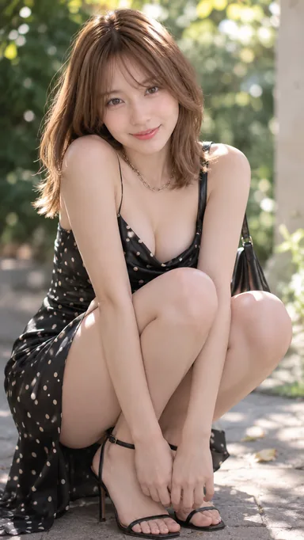
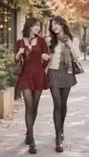

# 08｜POSEWEAR RANDOM · 随机三合一写真

> **人像 × 姿势 × 服装 → 真实感专业写真**。支持 SOLO 单人模式与 DUO 双人互动模式，自动依据人物和服装匹配室内外场景、布光与浅景深。

素材网站：[PoseWear](https://posewear.pages.dev/) · [打开 Skill](skill/posewear-random/SKILL.md) · [案例索引](案例/README.md)

## 两张最新案例

用户提供两张完成图片作为展示案例。第一张是单人低位蹲姿，第二张在同一人物、服装与环境下加入第二位白裙人物，从后方自然环抱。**它们不是本轮从 PoseWear 随机抽出的素材，切勿虚构参考编号。**

| 01 SOLO｜绿荫波点裙蹲姿 | 02 DUO｜绿荫双人环抱 |
| --- | --- |
| [](案例/01_单人_绿荫蹲姿.md) | [](案例/02_双人_绿荫环抱.md) |
| [案例拆解与完整提示词](案例/01_单人_绿荫蹲姿.md) | [双人动作与完整提示词](案例/02_双人_绿荫环抱.md) |
| [较高清图](assets/solo-full.webp) | [较高清图](assets/duo-full.webp) |

两张图的原始 PNG 为 941px 宽；仓库放入同像素尺寸的高品质 WebP 转码和 384px 宽预览，而不是原生 8K 或 Nikon 真机证据。

## 模式与流程

| 模式 | 来源素材 | 任务 |
| --- | --- | --- |
| SOLO 单人 | 人像 ×1、单人姿势 ×1、服装 ×1 | 严格融合身份、动作、服装，专业人像摄影 |
| DUO 双人 | 人像 ×2、已核实双人姿势 ×1、服装 ×2 | 固定两人关系、双人手臂接触与衣着归属 |
| SOLO→DUO 延续 | 用户给单人成片 + 第二人设计 | 锁定单人身份、姿势、服装与场景，仅新增互动人物 |

1. 浏览 PoseWear 人像、姿势、服装素材库；从**真实可见的条目**随机抽取，记录来源 ID、链接和类别。双人姿势如果无法核实，应标记自定义，不可假冒网站条目。
2. 人像决定脸部和发型；姿势决定重心、手臂与腿部位置；服装决定剪裁、面料、鞋履和配饰。不能相互覆盖参考职责。
3. 根据穿搭和人物气质选择真实可行的户外/室内场景；模拟 Nikon Z8/Z9 全画幅肖像摄影视角、柔和真实光线与自然光学背景虚化。
4. 默认输出 9:16 单张作品；检验正确人数、身份归属、姿势与服装保真、双人手指和遮挡关系、皮肤细节、背景透视。
5. 记录实际生成图片像素。**8K 是精细质感目标，不可把不足 8K 的图标成原生 8K。**

## 快速使用

```text
使用 $posewear-random，SOLO 模式：从 PoseWear 随机抽 1 人像、1 姿势、1 服装；
锁定三项来源与动作；根据服装自动匹配真实场景、光线与背景虚化；
生成一张9:16 Nikon Z8 风格专业写真，附可核实来源和质量检查。
```

```text
使用 $posewear-random，DUO 模式：随机 2 人像、1 个真实双人姿势、2 套服装；
根据服装协调同一环境与摄影机位，两位人物必须形成真实互动；
若双人姿势库无法核实，不要假报素材来源。
```

```text
使用 $posewear-random 的单人→双人延续模式：以我提供的单人图固定
人物身份、服装、深蹲姿势与背景，在她身后增加一位白裙成年女性，
使新人物自然蹲下从后方环抱，保持光照、画幅与摄影质感一致。
```

## 资料与安装

[Skill 主文件](skill/posewear-random/SKILL.md) · [随机来源规范](skill/posewear-random/references/selection.md) · [摄影质检](skill/posewear-random/references/photography-qa.md) · [单人提示词](skill/posewear-random/prompts/solo.md) · [双人提示词](skill/posewear-random/prompts/duo.md) · [来源声明](NOTICE.md)

可将完整 `skill/posewear-random` 目录复制到支持 Skills 的 Agent 技能目录。该 Skill 不包含第三方完整图库或生成模型；图片可作为独立视觉参考使用。材料与来源许可请自行核实。
