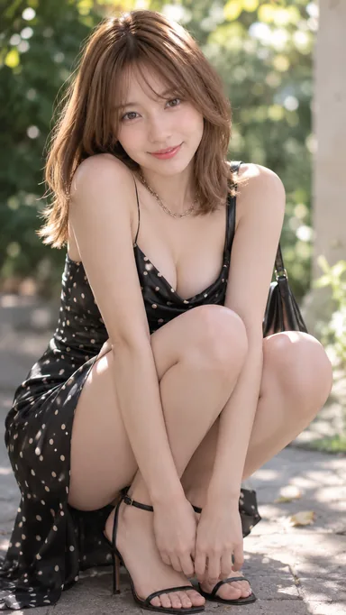

# 案例 01｜秋日庭院 · 单人写真

[返回 08 玩法](../README.md) · [SOLO 主提示词](../skill/posewear-random/prompts/solo.md)



**预览说明：** 这是前次聊天已生成的 AI 成片缩略图（宽 128px），并非原始完整分辨率文件。

## 本轮参考与来源

| 槽位 | 参考 | 信息 |
| --- | --- | --- |
| 人像 | S366 | 成年东亚女性；柔和五官、深棕中发、轻盈刘海。原对话记录链接：[人像来源](https://posewear.pages.dev/portrait/f788b1333df/) |
| 姿势 | P025 | **正面站立、双手叉腰、双脚自然分开**。[姿势来源](https://posewear.pages.dev/pose/full_single_P025/) |
| 服装 | AUT-0156 | 棕色短款罗纹针织开衫、奶油白吊带、深棕多层荷叶边裙、深色袜与厚底短靴、蝴蝶结包。[服装来源](https://posewear.pages.dev/costume/AUT-0156/) |

*来源记录基于此前对话实际抽卡展示；如果网站路径变更，请以 PoseWear 的可访问条目为准。此案例没有在仓库中存储 PoseWear 第三方原始参考图片。*

## 成片方案

- **构图**：9:16 正面全身；双肘向外，双手固定腰胯，头顶和靴底完整。
- **摄影**：Nikon Z8 风格模拟、85mm、f/2.2、柔和秋日下午侧光；双眼清晰，焦外石墙/枝叶自然散景。
- **气质**：柔和亲切的成年东亚女性，秋季轻复古时尚写实写真。
- **视觉成果**：已在本次聊天前一轮实际生成单张全身肖像，背景为秋日石砌小径与浅色建筑。生成的是单张图，而不是三素材拼贴。
- **真实性**：本地生成图不等于尼康实拍，原始输出约 **941×1672 px**；细节目标为 8K，不应标成原生 8K。

## 可复用案例提示词

```text
一个明确成年的东亚女性，脸部与深棕及肩中发遵循人像 S366；
严格模仿姿势 P025：正面直立、双手叉腰、手肘向外、双脚略分开，
全身包含双靴完整入画。完整穿搭遵循 AUT-0156：
巧克力色修身短开衫、奶油白吊带、深棕多层荷叶边长裙、
棕色短袜带蝴蝶结、黑色圆头厚底短靴和棕色单肩包。
秋日石墙小径、暖色树叶、柔和下午侧逆光，背景自然光学散景。
9:16 竖版全身，模拟 Nikon Z8 85mm f/2.2 专业商业人像摄影，
双眼对焦，皮肤有真实毛孔与肤色层次，精细衣物褶皱，
不可改变姿势，不多手指、不裁掉鞋、无文字和拼贴。
```

**验收记录**：单人数量符合；叉腰与全身构图符合描述；红人脸、身份是否像素级一致不可核实；服装层次可见；不是原生 8K。用户可据此重抽或局部修正。
