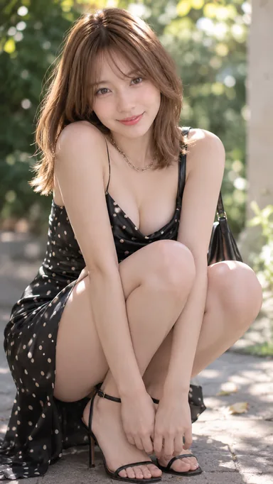

# 01｜绿荫波点裙 · 单人蹲姿写真（SOLO）

[返回 08 玩法](../README.md) · [SOLO 模板](../skill/posewear-random/prompts/solo.md) · [查看双人延续](02_双人_绿荫环抱.md)

[](../assets/solo-full.webp)

[打开案例大图：941 × 1672 WebP](../assets/solo-full.webp)

## 案例定位与来源

**由用户在当前对话直接上传的完成图**，不是从 PoseWear 网站随机抽出的结果。不能为它虚构人像、姿势或服装编号，也不能把图片视觉效果描述成已证实的 Nikon 实机拍摄。

源文件：`b2344f4d-ac64-4e8c-8420-cc4fb74395ab.png`（941 × 1672 px）；仓库中使用等画幅、高品质 WebP 转码及 384px 宽的轻量预览。原 PNG 未在仓库直接发布。

## 姿势、穿搭与摄影拆解

| 维度 | 从图像可见的特征 |
| --- | --- |
| 人物 | 外观成年的东亚女性，栗棕色蓬松层次中长发、轻薄刘海、自然微笑，面朝镜头 |
| 穿搭 | 黑色细肩带垂褶吊带长裙，米白色小波点，侧开衩与落地裙摆；银色链状项链、黑色小肩包、黑色细带高跟凉鞋 |
| 姿势 | **贴近镜头的低位深蹲**，两膝上收靠近身体，上身微微前倾，手臂自然向下，双手靠近脚踝和鞋面，脚掌支撑真实 |
| 场景 | 浅色石板地面、右侧浅色柱体、绿树与树荫；背景为大面积真实明亮圆形散景 |
| 光影 | 阳光穿过绿叶，暖金色侧逆光勾勒发丝和肩膀，面部接受柔和天光补亮 |
| 画幅 | 9:16 竖版，完整表现头顶、低位蹲姿、裙摆与两只高跟凉鞋 |

**核心控制点：** 不要把低蹲姿势改成站姿、跪姿或坐姿；不能遗漏脚趾、细带鞋和被裙摆遮挡的腿部结构。

## 可复现提示词

```text
9:16 竖版高级真实环境人像，一位明确成年的东亚女性，
栗棕色蓬松层次中长发、轻薄刘海、柔和微笑，正视镜头。
镜头前低位深蹲，两膝自然收起，上身向前略倾，
双臂向下伸至膝间，两手靠近脚踝与鞋面，脚跟和脚尖完整可见。
黑色细肩带缎面吊带裙，浅米色细小波点，领口自然垂褶、
侧开衩与落地裙摆，银色链状项链、黑色皮质小肩包、
黑色细带高跟凉鞋。服装遮挡、裙摆张力和肢体受力物理合理。
浅色石铺小径、右侧浅米色立柱、身后层叠绿叶和奶油色散景。
阳光穿过树荫形成细腻发丝逆光，脸部由柔和漫射光提亮，
背景真实光学虚化，皮肤保留微小毛孔、绒毛与真实色差。
模拟 Nikon Z8 全画幅 85mm f/2.8 人像摄影质感，眼睛精准对焦，
自然曝光，清晰主体与焦外的距离层次真实。
恰好一人，姿势准确，不裁鞋、不多手指、不漂浮、不塑料磨皮、无字。
```

**质量记录：** 已看到并核对上传图片中的人数、动作、服装与场景。镜头与光圈是生成复现的设计参数，不是原图 EXIF；未核验任何 PoseWear 随机素材。
