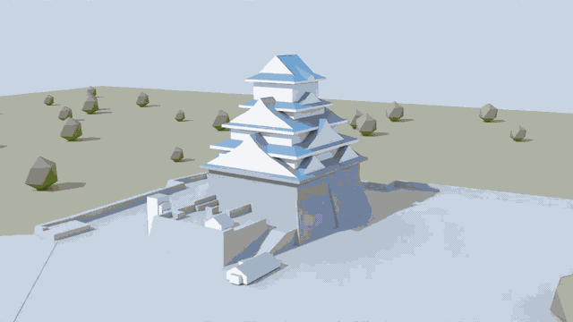
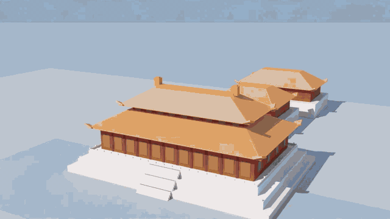

# 09｜地标建筑3D末帧接龙

[返回首页](../../README.md) · [查看大阪城案例](案例/大阪城_PLATEAU数据版/README.md) · [查看太和殿案例](案例/故宫太和殿_程序化建模版/README.md) · [打开 Skill](skill/landmark-3d-chain/SKILL.md)

用真实三维数据（或按真实规制在 Blender 里建的模型）渲染一张静止画，再以它为起点做 3 段各 10 秒的图生视频，**每段只把上一段的最后一帧作为唯一参考图**接龙，最后硬拼成精确 30.000 秒的环绕—穿门—俯瞰短片。

灵感来源：X 上 @noel_ai_lab（のえる｜AI構築者）2026-11-06 的大阪城帖——用日本国土交通省 PLATEAU 大阪市三维数据在 Blender 里做静止画，再做 3 段视频（绕周围转／穿过大门向上／从天空俯瞰），只把前段最后一帧传给下一段。本模块把这套做法完整复现了两次，并把数据源、验收标准和踩过的坑都写成了可复用的 Skill。

## 看效果

| 大阪城｜PLATEAU 数据版 | 故宫太和殿｜程序化建模版 |
| --- | --- |
|  |  |

上方为两支成片的全程预览 GIF（640×360、3 fps 抽帧、56/44 色量化，加载慢时可直接打开案例页下载 MP4）。两支成片均为 1280×720、24 fps、精确 30.000 秒／720 帧。

[大阪城案例与文件](案例/大阪城_PLATEAU数据版/README.md) · [太和殿案例与文件](案例/故宫太和殿_程序化建模版/README.md) · [两个案例的路线对比](案例/README.md)

## 两种数据路线

起点静止画必须来自真实几何，而不是 AI 凭空画一张图——这是这个玩法和普通图生视频的分界。几何从哪来有两条路，两个案例各走了一条：

| | 路线 A：开放三维数据 | 路线 B：按规制程序化建模 |
| --- | --- | --- |
| 做法 | 下载官方/开放的三维城市数据，导入 Blender 摆机位渲染 | 查公开资料核对建筑关键尺寸，在 Blender 里用脚本按米制比例建模、扁平上色 |
| 适用 | 日本建筑（PLATEAU 有全国 CityGML）；其他有开放 3D 数据的城市 | 没有开放数据、但规制尺寸公开的建筑（中国古建多属此类） |
| 案例 | 大阪城：PLATEAU 网格 52350422，天守在数据中实名存在，LOD2 共 209 面 | 故宫太和殿：面阔 63.96m、三层台基 8.13m、通高 35.05m，尺寸两源核对 |
| 精度边界 | 数据本身的 LOD 精度；建筑本体往往无纹理，按法线近似上色 | 规制尺寸真，细部（斗拱、雕刻、屋面曲线）为建模级近似，必须如实披露 |

还有一条被验证**不可行**的路：网上能匿名下载的现成模型。精细模型（Sketchfab CC 授权、CGTrader 免费等）下载都要平台账号；唯一匿名能拿到的故宫 GLB 只有 244 个面，渲染出来是红盒子加平板盖，完全不可辨认。细节见 [太和殿案例的数据调研](skill/landmark-3d-chain/references/taihedian-case.md)。

## 流程概览

1. **环境**：Blender 便携版免安装解压，无 GPU 时用 Cycles CPU 出图（1280×720 约 2 分钟/帧）。Blender 只出静止画，不渲染视频。
2. **数据源决策**：按上面两条路线取几何；先在数据里核查主体存在、精度和实测尺寸，再导入。
3. **静止画验收闸门**：1280×720 最佳观赏面高位斜俯瞰。第一眼认不出这座建筑（标志性识别三件套缺一不可）就不许进入视频段，先调材质/机位重渲。
4. **三段视频接龙**：第1段环绕一周、末帧落在正面低位；第2段穿门、登台、贴体上升、停在屋顶最高点特写；第3段后拉爬升到高空大全景。每段只喂上一段的最后一帧。
5. **拼接**：ffmpeg 硬拼并截到 720 帧——直接拼会多 1 帧变 30.07 秒，不合格。
6. **验证**：每段抽帧查运镜落点，接点前后帧（9.9s vs 10.1s、19.9s vs 20.1s）对比构图连续性，专查屋顶层数/台基层数有没有增生。

完整流程、提示词写法和常见坑见 [SKILL.md](skill/landmark-3d-chain/SKILL.md)；两个案例的全流程实录见 [大阪城实录](skill/landmark-3d-chain/references/osaka-castle-case.md) 与 [太和殿实录](skill/landmark-3d-chain/references/taihedian-case.md)。

## 怎么使用

### 第一步：定案例

先想好四件事：建筑是谁、在哪座城市、它的**标志性识别三件套**是什么（静止画验收就按这个查）、第2段要穿哪道门、第3段全景要收进哪些周边地标。

### 第二步：安装 Skill

1. 下载仓库，找到 [landmark-3d-chain 文件夹](skill/landmark-3d-chain/)；也可以从仓库首页使用 **Code → Download ZIP** 下载整个仓库。
2. 将整个 `landmark-3d-chain` 文件夹复制到 Codex 的技能目录，保留 `SKILL.md`、`references`、`scripts` 和 `assets` 等子目录。
3. 开启新的 Codex 对话，在需求中写上 `$landmark-3d-chain`，并填好第一步的四件事。

安装只提供制作流程和校验脚本，不会自动安装 Blender 或生成模型。具体配置见 [Skill 使用说明](skill/landmark-3d-chain/README.md)。

### 第三步：描述你想要的效果

以下内容可以复制后按需修改：

```text
使用 $landmark-3d-chain，做一个地标建筑 30 秒末帧接龙视频。
建筑：［填写名称］；城市：［填写］。
识别三件套：［例：五层绿瓦顶＋白墙＋石垣台基］。
第2段穿的门：［填写］；第3段全景要收进：［填写周边地标］。
先出 Blender 静止画给我验收，第一眼认不出来就停在静止画迭代，
不要往视频段走。通过后再做 3 段接龙，成片要精确 30.000 秒，
交付时如实列偏差清单。
```

### 第四步：检查与交付

静止画先过验收闸门；成片交付前用包内 `scripts/verify_frames.sh` 实测帧数与接点。技术检查和制作者视觉自检不等于用户验收，两个案例的用户定版状态见各自案例页。

## 适用与不适用

**适用**：有开放三维数据、或规制尺寸公开可查的地标建筑；想要“真实几何打底、AI 补写实质感”的航拍感短片；能接受视频段的地理与细节由模型发挥、并如实标注。

**不适用**：要求建筑细节测绘级准确（视频模型会自行发挥细部）；主体在任何数据源里都不可辨认、又无公开尺寸可建模；要求一镜到底 30 秒（本玩法是三段硬拼，接点靠末帧对齐，不是单次生成）。

## 使用前请注意

- **静止画是模型感画面。** Blender 起点是扁平色块、无真实纹理，写实质感由视频模型补全；不要把成片当作实拍或测绘成果。
- **视频段有模型发挥。** 远景地理、局部细节（如太和殿案例里被画成整条金龙的大吻）是视频模型自创，与实景不完全一致的地方已在各案例偏差清单中点名。
- **留意数据与模型授权。** PLATEAU 数据按其官方条款使用；Sketchfab/CGTrader 等平台模型需遵守各自许可（如 CC-BY 需署名），下载要账号的不要绕过登录。
- **标清生成方式。** 分享作品时说明起点是三维数据/规制建模、视频段为 AI 生成，避免让观看者误以为是实拍航拍。
