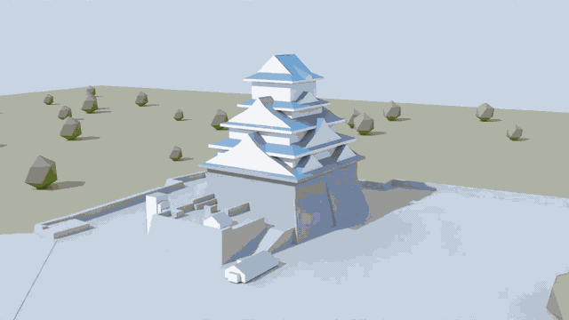

# 大阪城｜PLATEAU 数据版 · 30 秒末帧接龙

[返回玩法](../../README.md) · [下载 MP4](osaka-castle-plateau-30s-final.mp4?raw=true) · [打开预览 GIF](preview.gif?raw=true) · [全流程实录](../../skill/landmark-3d-chain/references/osaka-castle-case.md)

复刻 X 上 @noel_ai_lab 的大阪城做法：PLATEAU 大阪市三维数据进 Blender 出静止画，再做 3 段各 10 秒视频——环绕、穿门上升、空中俯瞰——每段只传上一段的最后一帧，硬拼成精确 30 秒。2026-11-07 完成。

## 目标与数据来源

- 目标：验证“真实三维数据打底＋末帧接龙”能否原样复现原帖效果，成片须精确 30.000s。
- 数据：日本国土交通省 PLATEAU 大阪市（27100）2025 年度仕様 5.0，按天守坐标只取网格 **52350422** 的 bldg（345 栋建筑）与 cons（石垣/城墙 LOD3）两个小文件；未下全市包与 DEM。
- 主体核查：天守在数据中实名存在（「大阪城天守閣」），实测高 **53.2 m**；LOD2 细节在 MultiSurface，合并 **209 面**，五层屋顶、白墙、石垣台基齐全；本体**无纹理**，渲染按几何法线近似上色（斜面绿瓦、竖面白墙、低部石垣灰）。

## 关键参数

| 项 | 值 |
| --- | --- |
| 渲染 | Blender 4.2.9 便携版，Cycles CPU 64 samples＋去噪（本机无 GPU，EEVEE 不可用） |
| 静止画 | 1280×720，东南机位 (95,−168,92)→(0,0,52)，40mm |
| 视频段 | 3 段 × 10.000s，1280×720，24fps，图生视频，仅以前段末帧为参考 |
| 拼接 | concat 重编码＋`-frames:v 720`＋音轨 atrim，成片精确 30.000s／720 帧 |

## 三段分镜与落点

| 段 | 内容 | 落点 |
| --- | --- | --- |
| 1 环绕 | 0s 为 Blender 静止画原帧，约 2.5s 起写实化，绕天守一周多面环绕 | 正面低位 |
| 2 穿门上升 | 下降至城门正面，穿石垣通道，贴墙上升 | 金色鲨瓦屋顶近景 |
| 3 空中俯瞰 | 从屋顶特写后拉爬升 | 高空大全景：护城河、公园、城市天际线 |

## 验收结果

- ffprobe 实测：1280×720、24fps、720 帧、30.000s、H.264＋AAC（哈希见 [文件校验](文件校验.json)）。
- 每段抽帧（0/2.5/5/7.5/9.9s）逐张看过：写实化完成、运镜到位；两个接点（9.9s vs 10.1s、19.9s vs 20.1s）构图几乎一致、无跳帧。
- 天守五层结构全程未增生、未变形——末帧接龙最典型的漂移（原帖作者东京站前作的时钟增生）未出现。
- 环境音轨已随成片生成，未实际试听。用户是否定版尚未记录。

## 偏差清单（如实）

- 起点段前约 2 秒仍是干净的 3D 模型感画面，之后才过渡为实拍质感。
- 静止画与原帖缩略图的差距：背景为公园绿地、无现代高楼天际线（高楼在本网格机位反方向）；无真实 DEM 地形与护城河水体；画面树木为手工散布的装饰球体，非 PLATEAU 数据。
- 第2段穿门后有一拍是通道内向视角（镜头看向通道内部）。
- 第3段爬升约 5s 即到位，后半程为高空全景缓慢漂移。

| 文件 | 规格 | 大小 |
| --- | --- | --- |
| 成片 MP4 | 1280×720，24 fps，30.000 秒／720 帧，H.264 + AAC | 26.47 MB |
| 预览 GIF | 640×360，3 fps 抽帧，90 帧，30 秒，无限重播 | 7.56 MB |
| Blender 静止画 | 1280×720 PNG | 1.00 MB |

GIF 是成片的缩小抽帧量化版本，画质低于 MP4；文件与本地定稿逐字节一致，上传时不重新编码。
