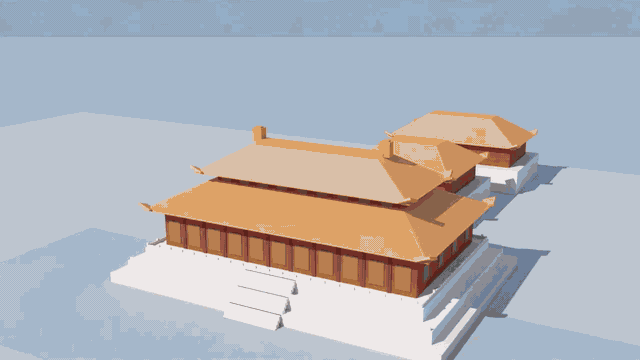

# 故宫太和殿｜程序化建模版 · 30 秒末帧接龙

[返回玩法](../../README.md) · [下载 MP4](taihedian-30s-final.mp4?raw=true) · [打开预览 GIF](preview.gif?raw=true) · [全流程实录](../../skill/landmark-3d-chain/references/taihedian-case.md)

把大阪城的做法搬到故宫：太和殿为锚点，同样的 Blender 静止画＋3×10s 末帧接龙＋精确 30 秒。区别在数据源——中国没有 PLATEAU 式开放数据，最终走“按真实规制在 Blender 里程序化建模”的路线。2026-11-07 完成数据调研，2026-11-23 建模并成片。

## 目标与数据来源

- 目标：用大阪城同款链法做故宫版；起点几何必须真实，不用 AI 画图冒充。
- 调研结论：故宫博物院不提供古建模型下载；Sketchfab 的 CC-BY 整组模型（167,309 面）、CGTrader 免费三大殿模型都卡在平台账号登录；唯一匿名可下载的 GitHub GLB 只有 244 面，实测渲染不可辨认，已弃用（详见[实录](../../skill/landmark-3d-chain/references/taihedian-case.md)）。
- 采用路线：按公开规制程序化建模。尺寸经中文维基与 visitbeijing 两源核对：面阔 11 间 **63.96 m**、进深 **37 m**、殿身高 **26.92 m**、三层汉白玉台基 **8.13 m**、通高 **35.05 m**、重檐庑殿顶、大吻 **3.40 m**。建模脚本见 [assets/build_taihedian.py](assets/build_taihedian.py)（Blender Python，按米制比例生成台基、殿身、双层庑殿顶与陪衬剪影）。

## 关键参数

| 项 | 值 |
| --- | --- |
| 建模 | Blender 4.2.9 便携版，Python 脚本程序化建模，扁平上色 |
| 渲染 | Cycles CPU 64 samples＋去噪，1280×720，每帧约 2.2–2.6 分钟，共 3 轮试渲定稿 |
| 静止画 | 1280×720，东南机位 (78,−142,68)→(0,0,24)，40mm |
| 视频段 | 3 段 × 10.000s，1280×720，24fps，图生视频，仅以前段末帧为参考 |
| 拼接 | concat 重编码＋`-frames:v 720`＋音轨 atrim，成片精确 30.000s／720 帧 |

## 三段分镜与落点

| 段 | 内容 | 落点 |
| --- | --- | --- |
| 1 环绕 | 0s 为静止画原帧，写实化后环绕太和殿、带贴顶掠过 | 金水桥＋大殿正面 |
| 2 穿门登台 | 过桥推近，沿台阶登临，穿正门门洞，贴檐上升 | 正脊大吻特写 |
| 3 空中俯瞰 | 从大吻后拉爬升，约 7.5s 到位 | 中轴线高空全景：护城河、红墙黄瓦建筑群、北京天际线 |

## 验收结果

- 静止画验收：三层白台基＋红墙十一间＋黄色重檐庑殿顶第一眼可辨，通过后才进视频段（试渲 3 轮的修正过程见实录）。
- ffprobe 实测：1280×720、24fps、720 帧、30.000s、H.264＋AAC（哈希见 [文件校验](文件校验.json)）。
- 每段抽帧逐张看过；两个接点（9.9s vs 10.1s、19.9s vs 20.1s）构图几乎一致、无跳帧；主殿台基三层与重檐两层全程未增生。
- 环境音轨已随成片生成，未实际试听。用户是否定版尚未记录。

## 偏差清单（如实）

- **建模级近似**：规制尺寸是真值；屋面为直坡无举折曲线，无斗拱，柱网是贴面柱线＋门窗纯色块，大吻为简化色块、无脊兽宝顶；台基是规整长方形（真实为土字形平面）、每层等分 2.71m 未核实、栏杆无龙头螭首、台阶无御路石雕。
- **陪衬取舍**：中和殿/保和殿为简化剪影（中和殿真实为圆形攒尖顶，此处按庑殿顶近似）；太和门剪影已建但在最终机位画外；午门、金水桥、筒子河未建；广场为无纹理色块平面。
- **视频模型发挥**：第1段环绕不是严格的东南→东→北→西→南正环，末帧落点地理为视频模型自创；第2段登台压缩为一段台阶＋门洞、非逐层三层，广场有少量远景游客背影；大吻被渲染成整条金龙雕塑（真实为龙头形吻兽）；第3段宫城地理是理想化拼贴，与实景方位不完全一致。

| 文件 | 规格 | 大小 |
| --- | --- | --- |
| 成片 MP4 | 1280×720，24 fps，30.000 秒／720 帧，H.264 + AAC | 18.68 MB |
| 预览 GIF | 640×360，3 fps 抽帧，90 帧，30 秒，无限重播 | 6.92 MB |
| Blender 静止画 | 1280×720 PNG | 1.01 MB |
| 建模脚本 | assets/build_taihedian.py（Blender Python） | 10 KB |

GIF 是成片的缩小抽帧量化版本，画质低于 MP4；文件与本地定稿逐字节一致，上传时不重新编码。
