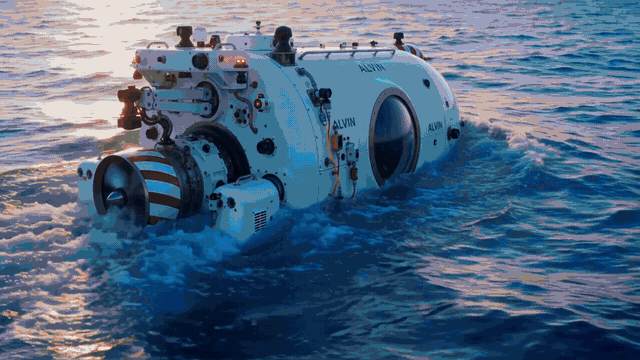

# 10｜深海下潜末帧接龙

[返回首页](../../README.md) · [打开 Skill](skill/deep-sea-descent-chain/SKILL.md) · [查看 5000m 跟拍案例](案例/深海5000米_艇外跟拍版/README.md) · [8000m 案例实录](skill/deep-sea-descent-chain/references/deep-sea-8000-case.md)

把一次深海下潜做成 60 秒"一镜到底感"的探索短片：先定**情绪弧**（如从明亮愉快到阴暗危险）和**六段深度分段表**，再用图生视频做 6 段各 10 秒、**每段只把上一段的最后一帧作为唯一参考图**的末帧接龙，硬拼成精确 60.000 秒。右侧的**深度监控 UI 不由视频模型生成**——模型画的数字必错——而是按深度曲线逐帧程序渲染后叠加，这是本玩法与普通图生视频的第二个分界。

## 看效果



上方为 0–5000m 艇外跟拍案例的全程预览 GIF：640×360、60 秒抽帧版，约 11 MB。成片 MP4 暂未上传本仓库。

[5000m 跟拍案例与文件](案例/深海5000米_艇外跟拍版/README.md) · [8000m 机舱案例实录（成片暂未上传）](skill/deep-sea-descent-chain/references/deep-sea-8000-case.md) · [两个案例对照](案例/README.md)

## 两种视角

| | 艇外同向跟拍 | 机舱第一视角（定版案例所用） |
| --- | --- | --- |
| 镜头 | 在潜艇外与艇同向跟拍，机位按段轮换（后方／侧面／后侧方／后上方／低角度近景） | 固定在舱内看舷窗，全程不动 |
| 结构锁 | 潜艇的形状、大小、数量不变 | 舷窗的形状、大小、位置与舱内布局不变 |
| 主要坑 | 段间机位轮换的衔接 | 段内后半段镜头被模型"推出舱外"（见下） |
| 已完成 | 0–5000m 版（全程静音） | 0–5000m 版、0–8000m 版（纯环境声，用户定版） |

## 流程概览

1. **开工四件事**：视角、目标深度与六段深度表（贴海洋学分带）、情绪弧与每段唯一事件、硬约束（文字/人物/声音逐项定死）。
2. **六段接龙**：第 1 段纯文本生成，第 2 段起每段只喂上一段最后一帧（`ffmpeg -sseof -0.05` 提取）。每段提示词带首帧锁定句、运镜模板句、结构锁定句、独立的声音设计段。
3. **构图验收门**（机舱版）：每段抽 0/2.5/5/7.5/9.9s 五帧，舷窗必须五帧全在，否则该段先重滚再拼接。实测教训：大生物贴玻璃/满框最容易触发镜头出舱，生物一律保持窗外 2–3 米。
4. **深度 UI 后期渲染**：按六段关键点**分段计速**（不是全程匀速——匀速会和画面深度对不上）逐帧渲染面板：DEPTH 读数＋单位 m、深度标尺、下降速度、分带名、STATUS 绿→黄→红。用包内 `make_depth_hud.py`＋`overlay_hud.sh` 叠到成片右侧。
5. **拼接**：concat 流复制硬拼＋`-frames:v 1440` 锁帧，成片精确 60.000s。
6. **验证**：ffprobe 实测规格、音轨音量实测、五接点抽帧对比、UI 读数抽帧核对（每段中点深度对分镜表中点）。

完整流程、提示词写法和常见坑见 [SKILL.md](skill/deep-sea-descent-chain/SKILL.md)；定版案例的全流程实录（含 v2 平顺版为何落选的复盘）见 [8000m 案例实录](skill/deep-sea-descent-chain/references/deep-sea-8000-case.md)，六段提示词原文见 [segment-prompts.md](skill/deep-sea-descent-chain/references/segment-prompts.md)。

## 怎么使用

### 第一步：定主题

想好四件事：目标深度、视角、情绪弧走向、六段各遇到什么（每段只定一件事），以及硬约束（要不要文字/人物/声音）。

### 第二步：安装 Skill

1. 下载仓库，找到 [deep-sea-descent-chain 文件夹](skill/deep-sea-descent-chain/)；也可以从仓库首页使用 **Code → Download ZIP** 下载整个仓库。
2. 将整个 `deep-sea-descent-chain` 文件夹复制到 Codex 的技能目录，保留 `SKILL.md`、`references`、`scripts` 和 `assets` 等子目录。
3. 开启新的 Codex 对话，在需求中写上 `$deep-sea-descent-chain`，并填好第一步的四件事。

安装只提供制作流程和脚本，不会自动生成视频。具体配置见 [Skill 使用说明](skill/deep-sea-descent-chain/README.md)。

### 第三步：描述你想要的效果

以下内容可以复制后按需修改：

```text
使用 $deep-sea-descent-chain，做一个深海下潜 60 秒视频。
目标深度：［如 8000m］；视角：［机舱第一视角／艇外跟拍］。
情绪弧：［如 明亮愉快 → 逐渐阴暗危险］。
每段事件：［六段各一件］。
约束：［如 无中文、无人物、无配音，纯环境声］。
深度 UI 要带单位 m 并按段计速，成片精确 60.000 秒，
交付时如实列偏差清单。
```

### 第四步：检查与交付

每段先过构图验收门再拼接；成片交付前用包内 `scripts/verify_frames.sh` 实测帧数、接点与 UI 读数。技术检查和制作者视觉自检不等于用户验收，定版状态见案例实录。

## 适用与不适用

**适用**：深海/下潜/探索题材的氛围短片；想要"数值 UI 可信"（深度读数与画面严格对应）的监控感画面；能接受视频段的生物形态与局部细节由模型发挥、并如实标注。

**不适用**：纪实或海洋学数据展示（深度曲线是叙事分段、非真实下潜剖面）；要求 60 秒单次生成一镜到底（本玩法是六段拼，靠末帧对齐＋验收门控制连续性）；要求舱内仪表出现可读文字/数字（模型生成必乱码，可读信息一律走后期 UI）。
