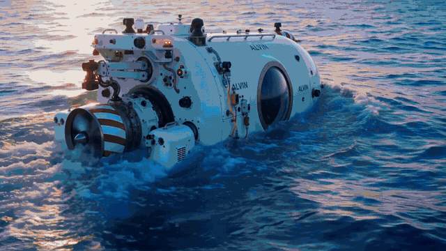

# 深海 0–5000m 探索｜艇外跟拍版 · 60 秒末帧接龙

[返回玩法](../../README.md) · [打开预览 GIF](preview.gif?raw=true) · [六段新版提示词模板](../../skill/deep-sea-descent-chain/references/segment-prompts.md)

白色深潜器从海面一路潜到 5000m 深渊平原：阳光带、暮光带、午夜带、深渊峡谷、热液黑烟囱、深渊平原，六段各 10 秒末帧接龙，镜头全程在艇外与潜艇同向跟拍、机位按段轮换，全程静音。2026-11-28 完成。

> 本案例只上传预览 GIF 与静止画，成片 MP4 暂未上传本仓库。

## 关键参数

| 项 | 值 |
| --- | --- |
| 视角 | 艇外同向跟拍，机位按段轮换（见下表），段内机位恒定、只缓慢推近 |
| 视频段 | 6 段 × 10.000s，1280×720，24fps，图生视频，仅以前段末帧为参考 |
| 拼接 | concat 流复制硬拼＋`-frames:v 1440`，成片精确 60.000s／1440 帧 |
| 声音 | 全程静音（无音轨） |

## 六段分镜

| 段 | 深度 | 机位 | 内容 |
| --- | --- | --- | --- |
| 1 | 0–200m | 后方跟拍 | 海面入水进阳光带，珊瑚礁与鱼群 |
| 2 | 200–1000m | 侧面跟拍 | 暮光带，光线渐暗 |
| 3 | 1000–2500m | 后侧方跟拍 | 午夜带，海洋雪＋生物发光点 |
| 4 | 2500–4000m | 后上方跟拍 | 深渊峡谷穿行 |
| 5 | 4000–4800m | 低角度侧面近景 | 贴近热液黑烟囱 |
| 6 | 4800–5000m | 后上方跟拍 | 抵达深渊平原停稳 |

## 验收结果

- ffprobe 实测（本地成片）：1280×720、24fps、1440 帧、60.000s、无音轨。
- 五个接点抽帧连续、无跳帧；白色深潜器形状与数量全程未增生。
- 预览 GIF 与本地成片逐帧对应（哈希见 [文件校验](文件校验.json)）。

## 偏差清单（如实）

- 第 2 段中段机位略偏向艇首灯光方向。
- 第 5 段后半变成机械臂近景，而非整艇侧面跟拍。

| 文件 | 规格 | 大小 |
| --- | --- | --- |
| 预览 GIF | 640×360，3 fps 抽帧，180 帧，60 秒，无限重播 | 约 11 MB |
| 代表静止画 | 1280×720 PNG（5s 帧） | 约 0.5 MB |
| 成片 MP4 | 1280×720，24 fps，60.000 秒／1440 帧，无音轨 | 暂未上传 |

GIF 是成片的缩小抽帧量化版本，画质低于 MP4。
